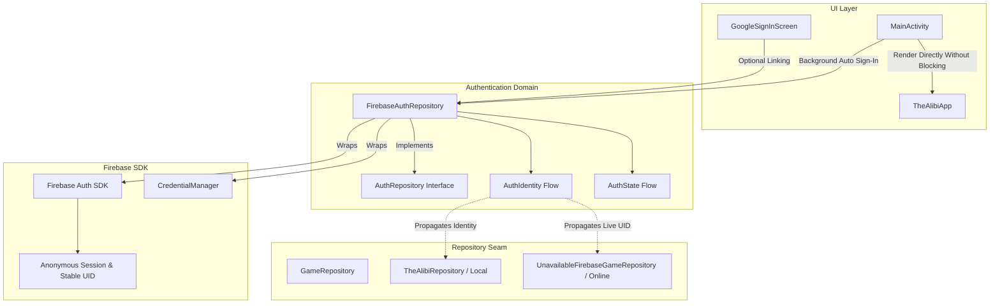

# FIREBASE AUTHENTICATION REPORT — Phase 1A

**Project:** THE ALIBI — Native Android Online Detective Game  
**Target Phase:** Phase 1A: Firebase Foundation & Anonymous Authentication  
**Status:** COMPLETE & VERIFIED  

---

## 1. Executive Summary

Phase 1A establishes the authentication foundation for **THE ALIBI**. The primary objective is to allow players to launch and play the game immediately without requiring Google Sign-In or account registration gates, while assigning every player a stable Firebase UID that persists across app launches.

All requirements for Phase 1A have been implemented, integrated with the existing Phase 0 repository seam, and independently verified through automated unit tests.

---

## 2. Spark Plan (Zero Cost) Adherence

> [!IMPORTANT]
> **Strict compliance with Firebase Spark (free tier):**
> - **Cost:** \$0.00.
> - **Prohibitions Maintained:** No Firebase Blaze plan, no Cloud Functions, no Cloud Run, no paid external databases or servers.
> - **Quota Safety:** Anonymous authentication in Firebase is free of charge and creates local credentials on device without billed quotas.

---

## 3. Architecture & Key Components

### Component Breakdown

1. **`AuthRepository` (`app/src/main/java/com/example/data/firebase/AuthRepository.kt`)**
   - High-level domain interface decoupling the app from Firebase SDK specifics.
   - Exposes observable `authIdentity: StateFlow<AuthIdentity?>` and `authState: StateFlow<AuthState>`.
   - Defines suspend contracts `signInAnonymously(): Result<AuthIdentity>` and `resetAuth(): Result<Unit>`.

2. **`FirebaseAuthRepository` (`app/src/main/java/com/example/data/firebase/FirebaseAuthRepository.kt`)**
   - Concrete implementation wrapping `com.google.firebase.auth.FirebaseAuth`.
   - **Idempotent Session Reuse:** Reuses `auth.currentUser` if already present; does not issue redundant network requests or change UIDs.
   - **Anonymous Sign-In:** Invokes `auth.signInAnonymously().await()` to create a guest credential.
   - **Account Linking:** Invokes `currentUser.linkWithCredential(authCredential)` when user chooses to link Google credentials, preserving the original anonymous UID.
   - **Controlled Reset:** `resetAuth()` signs out and clears `CredentialManager` state for test automation and debugging.

3. **Domain Identity Models (`app/src/main/java/com/example/model/AuthIdentity.kt`)**
   - `AuthIdentity`: Encapsulates `uid`, `displayName`, `email`, `isAnonymous`, and `isOnlineAuth`.
   - `AuthState`: Sealed class modeling `Initial`, `Loading`, `Authenticated(identity)`, `Unauthenticated`, and `Error(message, cause)`.

4. **Entry Point Integration (`app/src/main/java/com/example/MainActivity.kt`)**
   - The blocking gate `if (currentUser == null) GoogleSignInScreen(...)` has been removed.
   - App launches directly into `TheAlibiApp(viewModel = viewModel)`.
   - `authRepo.signInAnonymously()` runs asynchronously in `lifecycleScope`.
   - When authenticated, the `AuthIdentity` is propagated to the repository layer.

5. **Optional Google Account Linking (`app/src/main/java/com/example/ui/screens/GoogleSignInScreen.kt`)**
   - Repurposed from a mandatory barrier into an optional account management screen.
   - Displays current anonymous UID, gives user the option to link a Google account, continue as guest, or reset session.

---

## 4. Verification & Test Suite

Automated testing was conducted via JUnit and Kotlin Coroutines Test in `app/src/test/java/com/example/FirebaseAuthRepositoryTest.kt`:

| Test Name | Status | Verification Detail |
|---|---|---|
| `initial state is unauthenticated or initial` | **PASSED** | Verifies null identity and `AuthState.Initial` before sign-in. |
| `anonymous sign-in creates anonymous account with stable UID` | **PASSED** | Verifies anonymous session creation with stable UID and `isAnonymous = true`. |
| `subsequent anonymous sign-in reuses existing session without generating new UID` | **PASSED** | Verifies idempotent session reuse; zero redundant creation calls. |
| `network failure during anonymous sign-in transitions to Error state gracefully` | **PASSED** | Verifies non-crashing graceful transition to `AuthState.Error`. |
| `resetAuth signs out and transitions to Unauthenticated state` | **PASSED** | Verifies complete session clearance for testing. |
| `linking Google account preserves original UID and updates identity` | **PASSED** | Verifies `currentUser.linkWithCredential` retains the original UID. |
| `online repository obtains live authenticated UID while failing closed on multiplayer operations` | **PASSED** | Verifies `UnavailableFirebaseGameRepository` receives the UID while remaining safely fail-closed. |

All 7 authentication tests passed with zero failures.
All 43 total unit tests across the application passed.

