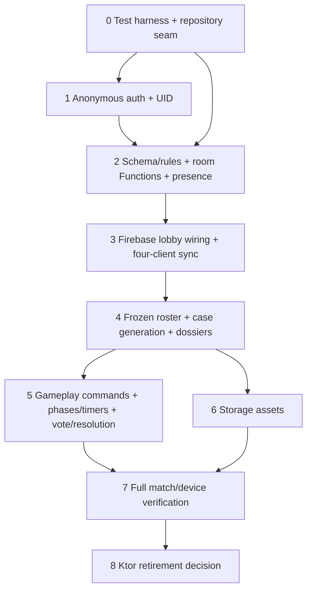

# Firebase implementation phases

This is a proposed sequence. None of these phases has been implemented by this planning task. Current state and risks are documented in `FIREBASE_MIGRATION_AUDIT.md` and `FIREBASE_SECURITY_AUDIT.md`.

## Dependency graph

**Critical path to a genuinely playable four-player online match:** 0 → 1 → 2 → 3 → 4 → 5 → 7. Storage (6) may follow without blocking text-only play if placeholders work. Ktor retirement (8) is intentionally last.

## Phase 0 — repeatable test harness and repository seam

**Scope:** Create an independently testable boundary while preserving current UI and keeping behavior unchanged. This is the recommended smallest first phase.

- **Files:** create `app/src/main/java/com/example/data/AlibiRepository.kt` (interface and contracts); modify `TheAlibiRepository.kt` to implement it without behavior change; modify `TheAlibiViewModel.kt` to depend on the interface; create a ViewModel factory/provider in `MainActivity.kt` or app DI location; create `functions/package.json`, `functions/tsconfig.json`, `functions/src/index.ts` skeleton only if choosing the shared Firebase emulator harness now; create `firebase.json` emulator entries for Functions/RTDB/Storage only after confirming ports; create `functions/test/*`, root `package.json` scripts and test docs. Existing `firestore.test.js` can be retained and wired rather than duplicated.
- **Services/dependencies:** Node LTS, Firebase CLI, `firebase-tools`, `@firebase/rules-unit-testing`, Firebase Admin/Functions test packages as applicable. No new runtime Firebase service usage yet. Keep existing Android dependencies.
- **Preconditions:** current project builds; baseline UI/game tests pass (baseline has not been run in this planning task).
- **Security:** test-only emulator project ID; never connect tests to production project; no secrets in fixtures.
- **Acceptance:** app still uses the same local implementation via interface; unit tests can inject a fake; one command starts configured emulators and runs a smoke test; generated docs state current Firebase gameplay remains unwired.
- **Automated tests:** repository contract tests; emulator startup/auth/firestore smoke test; `firestore.test.js` wired to actual test command.
- **Manual verification:** launch existing demo and confirm room creation/navigation still behaves as before; run emulator script from clean checkout.
- **Rollback:** revert interface/provider and test harness commits independently; no production schema or data changed.

## Phase 1 — anonymous-first auth and identity plumbing

- **Files:** modify `FirebaseAuthRepository.kt` (anonymous sign-in, auth state/error handling, Google `linkWithCredential`); modify `MainActivity.kt` (loading/error/anonymous entry state, remove compulsory Google gate); modify `GoogleSignInScreen.kt` into optional link/account surface; modify `TheAlibiViewModel.kt` and repository interface to receive Firebase UID from auth source; modify `app/build.gradle.kts` only if required for Auth APIs; add/update Auth emulator tests under `functions/test` or app test harness.
- **Services/dependencies:** Firebase Auth anonymous provider enabled in project (manual console/deployment prerequisite); Auth Emulator; Google provider configuration only for link flow.
- **Preconditions:** Phase 0 complete.
- **Security:** actor UID always from Firebase Auth; never accept UID in client command payload as identity; do not log ID/access tokens.
- **Acceptance:** cold launch creates anonymous session without registration; process restart retains same UID; link Google credential preserves exact UID; cancellation leaves anonymous session active; collision surfaces explicit merge decision and does not switch user.
- **Automated tests:** Auth emulator sign-in/restart persistence where supported; mock/test that link leaves UID stable; collision handling state tests.
- **Manual verification:** Android device with Play Services, anonymous quick entry, link Google, sign out policy review, clear app data demonstrates new anonymous identity and documented recovery limitation.
- **Rollback:** feature flag restores prior sign-in UI temporarily; keep anonymous account records valid; do not migrate/delete accounts on rollback.

## Phase 2 — secure schema, Functions room lifecycle, and presence

- **Files:** create `functions/src/rooms.ts`, `functions/src/auth.ts`, `functions/src/presence.ts`, `functions/src/scheduled.ts`, `functions/src/shared/schema.ts`, `functions/src/shared/errors.ts`; create `functions/package.json`, lockfile, config/tsconfig; modify `firestore.rules` (deny client writes, membership reads), create `database.rules.json`; modify `firebase.json`; create `storage.rules` default deny; add Emulator rules/function tests under `functions/test`; add Android `FirebaseRoomRepository.kt` command/listener adapter and `FirebasePresenceRepository.kt`; modify `FirestoreModels.kt` for target DTOs and `gradle/libs.versions.toml` + `app/build.gradle.kts` for Functions/RTDB dependencies.
- **Services/dependencies:** Auth, Firestore, Functions v2, RTDB, Emulator Suite; App Check provider selected for production later. Firestore indexes only when queries require them.
- **Preconditions:** Phases 0–1; agree on schema and migration policy (no existing live Firebase room data assumed; verify before deployment).
- **Security:** no direct client writes to room/membership/roster; membership-required reads; immutable host UID; code reservation server-only; callable auth+App Check+membership+transaction checks; RTDB UID path bound to auth and membership; scheduled cleanup has retention safeguards.
- **Acceptance:** create and join are atomic/idempotent; six-digit collisions retry; simultaneous attempts never exceed capacity; readiness is self-only and lobby-only; freeze is host-only and freezes exactly eligible roster; presence disconnect removes connection, online status reflects any active connection; cleanup expires and purges only eligible rooms.
- **Automated tests:** emulator rules denial matrix; Functions unit/emulator tests for code collisions, duplicate join, concurrent join/capacity, unauthorized host actions, ready/freeze race, stale room cleanup, onDisconnect behavior.
- **Manual verification:** two emulator clients, then four distinct auth contexts; verify online/offline UI and reconnect. No production deployment yet.
- **Rollback:** deploy prior rules/functions release if safe; keep schema additive and versioned; disable new client entry through feature flag; never reopen insecure broad write rules as rollback.

## Phase 3 — Firebase lobby as actual application path

- **Files:** modify `AlibiRepository.kt` contracts; implement `FirebaseAlibiRepository.kt` or expand `FirebaseRoomRepository.kt`; modify `TheAlibiViewModel.kt` create/join/ready/leave/observe paths and factory; modify `LobbyScreen.kt`, `CreateRoomScreen.kt`, `JoinRoomScreen.kt` only for loading/errors/online status as necessary; update `FirestoreModels.kt`; add repository/viewmodel tests.
- **Services/dependencies:** Auth, Functions, Firestore, RTDB from Phase 2.
- **Preconditions:** Phase 2 deployed to emulators; product confirms minimum 4, max 10 settings and ready policy.
- **Security:** online actions fail closed; no local repository fallback; show distinct labeled demo mode if retained; do not expose session token scheme.
- **Acceptance:** app uses Firebase for online create/join/roster/readiness and reattaches listeners by room ID; four clients converge on same room/member state; app restart restores selected room only when member record exists.
- **Automated tests:** ViewModel with fake repository; Firebase repository emulator integration; four distinct auth contexts; listener initial-state and reconnect tests.
- **Manual verification:** four emulator instances/clients join one room, ready toggles synchronize, host starts freeze, late join denied, all clients see same authoritative roster.
- **Rollback:** feature flag back to explicitly labeled demo route; preserve server room documents; do not represent demo room codes as online.

## Phase 4 — frozen roster, trusted case generation, assignments, dossiers

- **Files:** port or extract `backend/server/.../GeminiClient.kt`, `CaseGenerationEngine.kt`, `validation/CaseValidator.kt`, relevant `models/CaseModels.kt`; add `functions/src/generation.ts`, `functions/src/tasks.ts`, `functions/src/caseValidation.ts`, `functions/src/assignments.ts`; modify backend generator only if extracting shared module; create tests under `functions/test` and fixture cases; modify `TheAlibiViewModel.kt` generation/reveal/dossier paths; implement `FirebaseGameplayRepository.kt` safe reads; extend DTOs in `FirestoreModels.kt`.
- **Services/dependencies:** Functions v2, task queue if callable duration inadequate, Secret Manager for Gemini key, Firestore, Auth; deterministic fallback fixture. Gemini API access is an external prerequisite and is not currently verified.
- **Preconditions:** Phase 3 can freeze a roster. Decide Kotlin port/shared module versus TypeScript reimplementation after checking Functions runtime compatibility. Current Ktor generator exists in source but is not Firebase-connected/deployed.
- **Security:** generation only from frozen roster; callable requester must be host; server writes roles/dossiers/solution; owner-only dossier read, including host denial; solution never enters public case; secrets remain server-side.
- **Acceptance:** generated case passes strict invariants: exactly one human culprit; victim NPC; all other humans innocent; unique character assignments; consistent chronology/evidence references/deduction path; no leakage in public DTO. One bounded repair attempt; then validated fallback or explicit retryable failure. Generation is idempotent per room/roster version.
- **Automated tests:** property/fixture tests for roster counts, assignment uniqueness, victim exclusion, exact culprit count, leaks/schema, validator repair and API-failure fallback; emulator permission tests for each dossier and solution.
- **Manual verification:** fake Gemini full flow first; controlled live Gemini test with sanitized prompts/credentials; inspect each of four users sees only their dossier and solution remains unavailable pre-resolution.
- **Rollback:** stop accepting generation jobs, keep lobby/case state unstarted; retry or use validated static case. Never fall back to local client-generated roles.

## Phase 5 — authoritative gameplay commands and full match state

- **Files:** create `functions/src/gameplay.ts`, `functions/src/messaging.ts`, `functions/src/voting.ts`, `functions/src/resolution.ts`; modify `firestore.rules`; expand `FirebaseGameplayRepository.kt`; modify `TheAlibiViewModel.kt` evidence, interrogation, deal, message, transition, timer, vote and resolution calls; modify Compose screens only for asynchronous status/visibility; update `FirestoreModels.kt`; add comprehensive Functions/rules tests.
- **Services/dependencies:** Functions, Firestore, Auth, App Check; scheduler/task queue for deadlines; RTDB from Phase 2.
- **Preconditions:** Phase 4 assigned case and owner dossiers; agreed phase-transition graph, evidence release policy, scoring rules and deal rules.
- **Security:** no client writes to gameplay state; function validates every actor/phase/target; immutable append-only events; secret ballot create once; private visibility scoped; revision checks and idempotency on every retry; resolution transaction happens once.
- **Acceptance:** server-authoritative evidence, interactions, deals, messages, phase/deadline, ballots, tally and awards. Concurrent submissions do not duplicate state; expired phase transition is deterministic; no premature vote/solution reads.
- **Automated tests:** rules direct-write denial for every collection; callable auth/phase/ownership tests; concurrent duplicate ballot and phase-expiry race; scoring golden fixtures; full match emulator test with four clients.
- **Manual verification:** run match in four clients, pause/background one client, wait phase deadline, reconnect, finish simultaneous voting, confirm same resolution/score everywhere.
- **Rollback:** feature-flag a server-maintained previous phase only through an admin recovery function; no client bypass write. Ability to pause matches and provide incident diagnostics; preserve immutable event history.

## Phase 6 — Storage assets and graceful fallback

- **Files:** create/modify `functions/src/assets.ts`; create `storage.rules`; modify `firebase.json`; port `ImageGenerationPipeline.kt` and image calls from `GeminiClient.kt` to trusted task worker; create `FirebaseAssetRepository.kt`; modify case/character/evidence/twist models only for versioned storage path/status; modify UI image loading/fallback surfaces; add Storage emulator tests.
- **Services/dependencies:** Cloud Storage, Functions/task queue, Secret Manager, Storage Emulator; Android Firebase Storage dependency.
- **Preconditions:** Phase 4 case schema/asset IDs stable; confirm image model availability and quotas before live integration.
- **Security:** server-only uploads, immutable/versioned paths, membership and release-gated downloads; validate content type/size; avoid public bucket ACLs and long-lived exposed URLs.
- **Acceptance:** poster, portraits, crime scene, key evidence and twist artwork upload/download for authorized members; missing image never blocks match and uses bundled placeholder; retries don't overwrite unrelated assets.
- **Automated tests:** Storage rules nonmember denial, member release access, client write denial, MIME/size validation and task retry/idempotency.
- **Manual verification:** inspect images on at least one Android device, revoke access after room expiry, simulate missing asset/network failure.
- **Rollback:** disable asset-generation job and serve bundled placeholders; retain old immutable objects until room retention expires.

## Phase 7 — release verification on emulators and Android devices

- **Files:** create `docs/FIREBASE_RELEASE_CHECKLIST.md`, `functions/test/e2e/*`, Android instrumentation tests; modify test scripts/config only as required; no gameplay schema change expected.
- **Services/dependencies:** full Firebase Emulator Suite; separate staging Firebase project; four physical Android devices or reproducible device/emulator mix; production-like App Check/OAuth and controlled Gemini credentials for integration run.
- **Preconditions:** Phases 0–6 acceptance met; deployed staging rules/functions reviewed; monitoring and rollback owner assigned.
- **Security:** run full attack matrix and verify deployed artifacts match reviewed commit; no secrets in APK/logs; callable abuse/rate behavior reviewed.
- **Acceptance:** four-client full match, concurrent join, role/dossier isolation, evidence/chat/deals, timed phase, simultaneous ballots, synchronized resolution, disconnect/reconnect, restart restoration all pass. Emulator results and physical-device results recorded separately.
- **Automated tests:** CI runs unit, rules, Functions, Storage and four-client emulator suites; capture seed/run IDs and artifacts.
- **Manual verification:** Android OAuth linking/collision, force-stop/relaunch, network interruption, presence cleanup, real Storage and controlled live Gemini path. These have not been performed.
- **Rollback:** keep staging isolated; production rollout gradual/feature-flagged; pause new room creation or generation on failures; preserve match data and provide server-side recovery. Never deploy permissive rules to “restore” service.

## Phase 8 — Ktor retirement decision

- **Files:** only after proof, remove/retire `backend/server` sources/build files and old Android OkHttp/WebSocket/REST helpers from `TheAlibiRepository.kt`; remove unused Gradle aliases/dependencies and obsolete backend configuration/docs; retain any pure generator code already extracted.
- **Services/dependencies:** Firebase production services and observability stable; no dependency removal until code search and build prove no call sites.
- **Preconditions:** Phase 7 passes and product confirms Firebase is sole online backend; verify no external Ktor consumers/deployments (unknown today).
- **Security:** retire legacy endpoints/credentials/hosts; do not leave an unauthenticated old service reachable; preserve audit logs and data retention policy.
- **Acceptance:** full repo search finds no active legacy endpoint/WebSocket use; clean Android/backend builds and all tests pass; production routing no longer depends on Ktor.
- **Automated tests:** CI plus static search guard for legacy endpoints; deployment smoke test.
- **Manual verification:** confirm online play works with Ktor service stopped; verify monitoring shows no legacy traffic before shutdown.
- **Rollback:** preserve tagged deployment/source artifact and reversible routing window; avoid deleting data/schema until traffic and retention checks complete.

## Recommended sequence and first independently testable slice

Implement phases 0, 1, 2, 3, 4, 5, then 7 as the critical path; phase 6 can proceed after case schema stabilizes; phase 8 last. The smallest independent first slice is **Phase 0**: define the repository interface, keep current repository behind it, add emulator test scripts/smoke coverage, and prove existing UI behavior is unchanged. It can be reviewed and reverted without touching production rules or user data. The first online capability should then be Phase 2 room create/join/readiness/freeze, followed immediately by Phase 3 four-client lobby verification.
