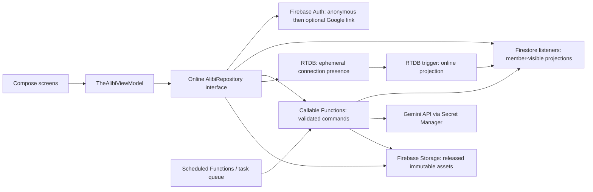

# THE ALIBI Firebase target architecture

This is a proposed target, not an implementation or deployment claim. See `FIREBASE_MIGRATION_AUDIT.md` for audited current state. Firebase repositories are currently unused by gameplay; there are no Functions, RTDB presence, Storage rules, or verified multiplayer clients.

## Service boundaries



Android owns presentation and user intent only. Firebase Auth owns identity. Firestore owns durable authoritative state and read projections. Callable Functions own every command/state transition. RTDB owns ephemeral connection registrations. Scheduled Functions own deadlines and cleanup. Storage owns generated binary assets. Gemini is called only by trusted server code. App Check is enforced for production calls where supported but does not replace authentication, membership validation, or authorization.

## Identity and room lifecycle

Anonymous Auth creates a stable UID on the installed app. Google linking attaches to that same Firebase user and preserves UID. Credential collision requires a deliberate account merge/membership migration; never silently change UIDs. Reinstall/data clearing may lose anonymous identity and requires linked credentials or explicit recovery policy.

Room code is a six-digit lookup token kept in `roomCodes/{code}`. `createRoom` transactionally claims an unused code and writes `rooms/{roomId}`, host member and server timestamps. `joinRoom` transactionally validates reservation, status, expiry, capacity and membership; retries are idempotent. The room UID is separate from the code. `hostUid` is immutable and determines host authorization; no `isHost` client field is authoritative.

Lobby membership records contain only public alias/readiness/seat and server-maintained online summary. `freezeRoster` checks all readiness and capacity requirements then stores an immutable roster and roster hash. No joins or readiness changes after freeze. Case generation consumes this frozen roster and its count.

## Proposed document model

```text
roomCodes/{code}                         server-only reservation
users/{uid}/myRooms/{roomId}              server-maintained room index
rooms/{roomId}                            public summary, hostUid, status, revision, deadlines
rooms/{roomId}/members/{uid}              alias, ready, seat, joinedAt (no secret role)
rooms/{roomId}/roster/frozen              immutable UID list/hash; no client write
rooms/{roomId}/case/public                sanitized public case version
rooms/{roomId}/dossiers/{uid}             private owner dossier, server write
rooms/{roomId}/solution/actual            secret solution; server only until resolution
rooms/{roomId}/evidence/{evidenceId}       released evidence projection
rooms/{roomId}/messages/{messageId}       immutable visibility-scoped message
rooms/{roomId}/deals/{dealId}              party-scoped deal projection
rooms/{roomId}/interactions/{eventId}      visibility-scoped interrogation/secret events
rooms/{roomId}/ballots/{uid}               immutable canonical ballot, hidden until resolved
rooms/{roomId}/resolution/final            server-authored final tally and scoring
rooms/{roomId}/requests/{requestId}         server-only idempotency/job state
```

Keep all solutions, hidden timelines, culprit identity, private secrets, ballot contents and unearned evidence out of the public case and room summary. The room summary exposes only phase/progress/deadline/revision and non-sensitive counts. A host is not a game administrator and does not receive players' dossiers.

## Command API

Callable commands: `createRoom`, `joinRoom`, `leaveRoom`, `setReady`, `freezeRoster`, `requestCaseGeneration`, `getMyDossier`, `discoverEvidence`, `shareEvidence`, `submitInterrogation`, `createInteraction`, `proposeDeal`, `respondToDeal`, `sendMessage`, `advancePhase`, `submitBallot`, `getResolution` (or resolution listener after completion). All use auth UID from callable context; validate membership, state, payload, rate and idempotency. Use a task queue/worker for slow Gemini and asset processing; client observes job status.

Server triggers: RTDB presence child changes update only derived online metadata; task completion stores validated case/assignment outputs; optional Firestore outbox trigger sends notifications. Scheduled Functions advance expired phases with revision/deadline transaction checks and expire/purge stale rooms. Triggers are idempotent because event delivery can repeat.

## Security and query behavior

Default deny. Every room-scoped read requires signed-in membership at `rooms/{roomId}/members/{uid}`. Client writes to authoritative room, role, dossier, roster, solution, evidence-unlock, deal-transition, ballot, resolution and request documents are denied. All mutations go through Functions. Functions independently recheck auth/membership/host/phase and use Firestore transactions; Admin SDK bypass means rules alone do not protect callable code.

Member clients can read room summary, roster fields, public case, released evidence and public messages. Dossier rule allows only `request.auth.uid == uid` and membership, with no host exception. Solution and ballots are unreadable by clients until server changes state; preferably ballots remain server-only and only aggregate/final result is exposed. Private messages are read by sender/recipient, public messages by members; clients query only a visibility/recipient-constrained collection path that rules can prove. Deals are readable only by parties, or through scoped projections. Do not query all rooms/messages then filter in the app. `users/{uid}/myRooms` permits only owner reads and is written by server.

Storage rules deny client writes. A member may read public/released room assets under a room membership check. Private assets are delivered via authenticated SDK read or a short-lived server-authorized URL after checking access. Use immutable versioned object names; server records asset status and checksum. Never store a solution in Storage or encode access in guessable names alone.

## Presence, listeners and time

RTDB tracks `/presence/{roomId}/{uid}/{connectionId}`. Each connection observes `/.info/connected`, registers `onDisconnect().removeValue()` before publishing online state, and writes a server timestamp. Multiple connections are tracked independently; disconnect trigger marks offline only when none remain. Presence is advisory and is not an authorization credential.

Firestore listeners are the authoritative client synchronization mechanism. On launch/reconnect the app authenticates, resolves its room ID from explicit user selection or owner-scoped index, reattaches only allowed listeners, reloads own dossier, and renders latest server revision. Firestore server timestamps are canonical. Each phase has `phaseStartedAt`, `phaseDeadline`, and monotonic `phaseRevision`; clients may estimate countdown using server offset, but only trusted scheduled/callable code advances the phase. A stale client command includes expected revision and fails safely.

## Android boundary and migration

Keep Compose screens and translate Firestore DTOs into existing UI models. Introduce a repository interface beneath `TheAlibiViewModel`; currently it defaults to `TheAlibiRepository()`, whose room state and game actions are in-memory. Repoint ViewModel room/game actions to suspend commands and snapshot Flows. Wire all mutation call sites, not only creation/join. Keep the old implementation only behind a visibly selected offline/demo entry, with no online room code or silent fallback. Remove Ktor/OkHttp legacy multiplayer only after feature parity, regression tests and product approval to retire it.

Reuse the Ktor `GeminiClient`, `CaseGenerationEngine`, `CaseValidator`, and image pipeline where practical, but port them into a Functions worker/shared JVM module or secure an existing service with Firebase token verification. Do not reuse Ktor's in-memory `RoomRepository` as persistence/authority. Verify build/runtime compatibility for Kotlin code in Node Functions before selecting shared-module approach; an alternative is a TypeScript worker with ported schema validator. No production service choice is verified yet.
